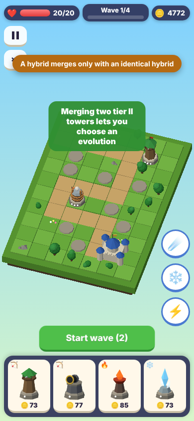
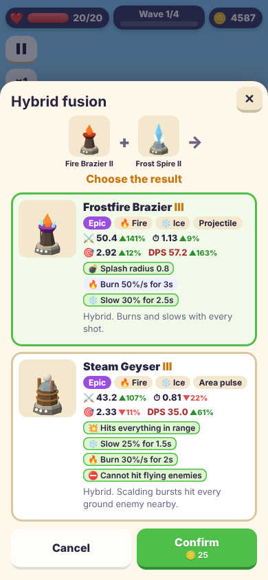
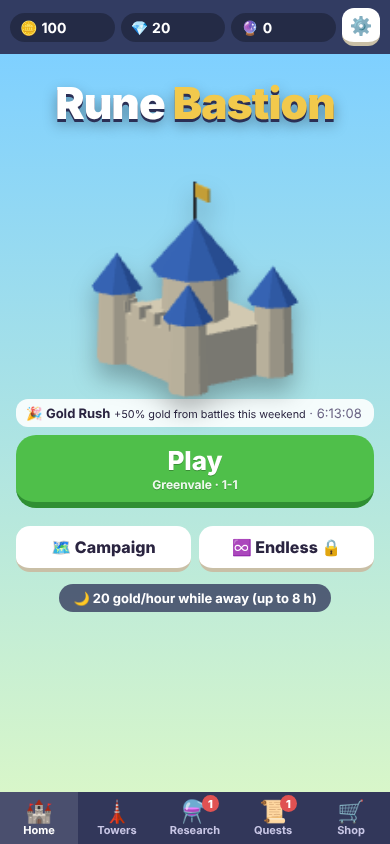

# Rune Bastion

Мобильная игра в жанре Tower Defence + Roguelike + Idle для Android и iOS: вертикальная
ориентация, изометрическая камера, мультяшное фэнтези. Игрок защищает замок, расставляя башни,
объединяя их, выбирая усиления после каждой волны и развивая аккаунт между боями.

  

## Состояние проекта

| Часть | Состояние |
|---|---|
| Игра (все механики, меню, три языка) | работает, покрыта тестами |
| Автотесты: 128 модульных и балансовых, 11 серверных, 125 сквозных, 7 для релизной сборки | все проходят |
| Android-сборка | собрана: `builds/rune-bastion-1.0.0-debug.apk` (отладочная подпись) |
| Запуск на реальных телефонах | **не выполнялся** — в среде разработки нет устройств и эмулятора |
| iOS | проект Xcode подготовлен, **не собирался** — нужен macOS с Xcode |
| Реклама и покупки | код интеграции написан; в настоящих магазинах **не проверялись** — нужны аккаунты разработчика |
| Вход через Google / Apple | сервер и клиент готовы; **не проверялись** с настоящими токенами — нужны идентификаторы приложений |
| Публикация в магазинах | **не выполнялась** |

Подробности: [что протестировано](docs/TEST_REPORT.md), [известные ограничения](docs/KNOWN_ISSUES.md).

## Важное решение: движок

В задании указан Unity. В среде, где велась разработка, Unity Editor запустить невозможно
(нет редактора и лицензии), поэтому игра написана на **TypeScript + Three.js** и упакована в
нативные приложения через **Capacitor 8**. Это позволило реально запускать игру, прогонять тесты
и симуляции баланса и собрать APK. Обоснование и путь переноса в Unity —
в [docs/ARCHITECTURE.md](docs/ARCHITECTURE.md#решения).

## Быстрый старт

Нужен Node.js 22+.

```bash
cd rune-bastion/game
```

```bash
npm install
```

```bash
npm run dev
```

Откройте адрес из консоли в браузере в режиме эмуляции телефона (или с телефона в той же сети).
В режиме разработки работают тестовая реклама и тестовый магазин — реальные деньги не списываются.

Тесты:

```bash
npm test
```

```bash
npm run e2e
```

Сборка под Android и iOS, запуск сервера, настройка рекламы и покупок — в [docs/BUILD.md](docs/BUILD.md).

## Что внутри

```
rune-bastion/
  game/            клиент игры
    src/core/      симуляция боя (без графики, детерминированная)
    src/data/      все игровые данные: башни, рецепты, враги, уровни, усиления, экономика
    src/meta/      правила аккаунта: награды, исследования, задания, офлайн-доход
    src/services/  сохранения, облако, реклама, покупки, звук, производительность, локализация
    src/render/    3D-сцена на Three.js, процедурные модели и эффекты
    src/ui/        экраны и HUD
    src/i18n/      тексты (генерируются из scripts/i18n.mjs)
    tests/         модульные тесты и симуляции баланса
    e2e/           сквозные тесты через интерфейс
    android/, ios/ нативные проекты Capacitor
  server/          сервер аккаунтов, облачных сохранений и проверки покупок (Node.js без зависимостей)
  builds/          готовая Android-сборка
  docs/            документация, отчёты, скриншоты
```

## Документация

- [Архитектура и принятые решения](docs/ARCHITECTURE.md)
- [Игровой дизайн: реализованные механики](docs/GAME_DESIGN.md)
- [Сборка, запуск и публикация](docs/BUILD.md)
- [Отчёт о тестировании](docs/TEST_REPORT.md)
- [Известные ограничения и ошибки](docs/KNOWN_ISSUES.md)
- [Рекомендации для следующих обновлений](docs/ROADMAP.md)
- [Описание для магазинов](docs/STORE_LISTING.md)
- [Данные и конфиденциальность](docs/PRIVACY.md)
